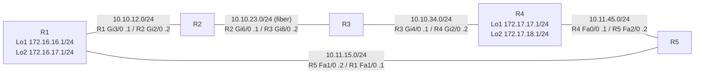

# RIPv2 Ring Lab (Cisco Packet Tracer)

A five-router ring running **RIP version 2**, with loopback networks on two routers and static routes with administrative distance 121 meant as a backup path. Built in Cisco Packet Tracer 8.2.0.

## Topology



## Addressing

| Router | Interface | IP address | Connected to |
|--------|-----------|------------|--------------|
| R1 | Gi3/0 | 10.10.12.1/24 | R2 Gi2/0 |
| R1 | Fa1/0 | 10.11.15.1/24 | R5 Fa1/0 |
| R1 | Loopback1 | 172.16.16.1/24 | - |
| R1 | Loopback2 | 172.16.17.1/24 | - |
| R2 | Gi2/0 | 10.10.12.2/24 | R1 Gi3/0 |
| R2 | Gi6/0 | 10.10.23.1/24 | R3 Gi8/0 (fiber) |
| R3 | Gi4/0 | 10.10.34.1/24 | R4 Gi2/0 |
| R3 | Gi8/0 | 10.10.23.2/24 | R2 Gi6/0 (fiber) |
| R4 | Gi2/0 | 10.10.34.2/24 | R3 Gi4/0 |
| R4 | Fa0/0 | 10.11.45.1/24 | R5 Fa2/0 |
| R4 | Loopback1 | 172.17.17.1/24 | - |
| R4 | Loopback2 | 172.17.18.1/24 | - |
| R5 | Fa1/0 | 10.11.15.2/24 | R1 Fa1/0 |
| R5 | Fa2/0 | 10.11.45.2/24 | R4 Fa0/0 |

All other interfaces are administratively shut down.

## Routing design

- **RIPv2** on every router (`network 10.0.0.0`, `no auto-summary`). R1 and R4 also include their `172.16.0.0` / `172.17.0.0` loopback networks.
- **Static routes with AD 121** toward the `172.16.x.x` and `172.17.x.x` space on every router. Since RIP has AD 120, these are floating statics that should only activate if RIP routes disappear. See [docs/ANALYSIS.md](docs/ANALYSIS.md) for a problem with their prefixes.

## How to use

1. Install Cisco Packet Tracer 8.2.0 or newer.
2. Build the topology and paste each file from `configs/` into the matching router CLI.
3. Wait for the links to come up (the fiber link R2-R3 needs fiber modules on both routers), then verify:

```
R1# show ip interface brief
R1# show ip route rip
R1# show ip protocols
R1# ping 172.17.17.1
R1# traceroute 172.17.17.1
```

By hop-count logic, R1 should reach R4's loopbacks through R5 (metric 2) rather than through R2 and R3 (metric 3).

## Notes

- The configs were extracted from the saved lab file and were not re-simulated while writing this documentation, so expected outputs are derived from the configuration.
- Device labels in Packet Tracer (Router2, Router3, ...) do not all match the hostnames. The docs use hostnames.

